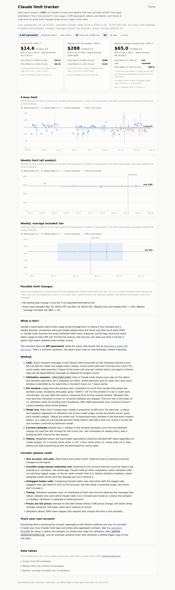

# Claude limit tracker

How much usage is **100%** of Claude's 5-hour and weekly plan limit bars actually worth?

This repo estimates it from real Claude Code usage on one account, in **API-equivalent dollars** and **tokens**,
and charts the estimate over time so that quiet limit changes show up as a step. The site is a static page in
[`docs/`](docs/) (GitHub Pages, no build step) and the numbers come from a dependency-free Python collector that
anyone can run on their own machine.



## How it works

Claude Code gets the exact utilization of every limit bar with each API response (`rate_limit_event` in
stream-json output, `rate_limits` in the status line input), and its transcripts record the exact token usage of
every call. Per limit window:

1. add up the usage of every logged call from the window's start to the sample where the bar peaks,
   priced at [Anthropic's API list prices](https://platform.claude.com/docs/en/about-claude/pricing) (`collector/prices.json`);
2. divide by the utilization reached: `100% ≈ usage / utilization`;
3. fit how much each model counts towards the bar (a robust non-negative regression over 10-point slices of every
   window), because plans don't weigh models in proportion to API price, and re-express each window in the dominant
   model's dollars;
4. take the median of recent windows as the current estimate, and run a rank-based change-point test over the
   series to flag possible limit changes.

The site explains the method and its caveats in more detail. The short version: one account, usage the machine
can't see (claude.ai, phone, other computers) pushes estimates **down**, and a few percent of Claude Code's own
helper calls never appear in transcripts (pushes them down too; the site shows a corrected range).

## Track your own account

Requirements: Python 3.8+ (standard library only), Claude Code on a Pro/Max plan, `git`.

### 1. Record utilization samples

Transcripts already have the token usage, but not the utilization. Pick one (or both):

- **Status line sampler** (works with normal interactive use). In `~/.claude/settings.json`:

  ```json
  "statusLine": {"type": "command", "command": "python3 ~/claude-limit-tracker/collector/statusline_sampler.py"}
  ```

  Already have a status line? Wrap it: `... statusline_sampler.py --then 'your existing command'`.
  It appends `{ts, window, resets_at, used_percentage}` to `~/.local/state/claude-limit-tracker/samples.jsonl`
  whenever a value changes, and prints a short status line (or your wrapped one).

- **stream-json logs**, if you run Claude Code headless:
  `claude -p "..." --output-format stream-json --verbose > logs/run-$(date +%s).jsonl`.
  Point the collector at them with `--streams 'logs/*.jsonl'`.

Tip: Claude Code deletes transcripts after `cleanupPeriodDays` (30 by default). The collector freezes closed windows
in `docs/data/estimates.json`, so history survives that, but if you want to be able to rebuild, raise it in settings.

### 2. Collect

```sh
git clone <your fork> ~/claude-limit-tracker && cd ~/claude-limit-tracker
python3 collector/collect.py                     # writes docs/data/estimates.json
python3 -m http.server -d docs 8000              # then open http://127.0.0.1:8000
```

Options (each also has an environment variable, handy for systemd):

| Option | Env | Default |
|---|---|---|
| `--transcripts GLOB` (repeatable) | `LIMIT_TRACKER_TRANSCRIPTS` (`:`-separated) | `$CLAUDE_CONFIG_DIR`, `~/.claude`, `~/.config/claude` → `projects/**/*.jsonl` |
| `--streams GLOB` (repeatable) | `LIMIT_TRACKER_STREAMS` | none |
| `--samples FILE` (repeatable) | `LIMIT_TRACKER_SAMPLES` | `~/.local/state/claude-limit-tracker/samples.jsonl` |
| `--out DIR` | `LIMIT_TRACKER_OUT` | `docs/data` |
| `--plan LABEL` | `LIMIT_TRACKER_PLAN` | none (shown on the site, e.g. `Max 20x`) |
| `--rebuild` | | keep frozen windows from earlier runs |

The collector only ever writes aggregate numbers: per-window timestamps, utilization, usage totals per public model
id, and the estimates. No paths, project names, session or account ids, prompts or message text.

### 3. Publish daily (optional)

1. Fork or create the repo on GitHub and push it.
2. Settings → Pages → *Deploy from a branch* → your default branch, folder `/docs`.
3. Install the timer (runs `collector/run_daily.sh` at 00:00 UTC: collect, privacy check, commit `docs/data`, push):

   ```sh
   mkdir -p ~/.config/systemd/user
   cp systemd/claude-limit-tracker.service systemd/claude-limit-tracker.timer ~/.config/systemd/user/
   # edit WorkingDirectory= in the service if your clone isn't ~/claude-limit-tracker
   # optional settings, e.g.: echo "LIMIT_TRACKER_PLAN=Max 5x" > ~/.config/claude-limit-tracker.env
   systemctl --user daemon-reload
   systemctl --user enable --now claude-limit-tracker.timer
   loginctl enable-linger "$USER"   # run even when you're not logged in
   ```

   `git push` needs working credentials for the repo (e.g. `gh auth login` + `gh auth setup-git`).

### Privacy check

`python3 tools/privacy_check.py` scans `docs/`, every tracked or about-to-be-added file and all commit metadata for
e-mail addresses, UUIDs and home-directory paths, plus any terms you list (one per line) in `local/deny.txt`
(git-ignored; put your name and account names there). `run_daily.sh` refuses to commit if it fails.
Also make sure your git `user.email` is a `@users.noreply.github.com` address before publishing.

## Files

| Path | What |
|---|---|
| `collector/collect.py` | the collector (stdlib only) |
| `collector/prices.json` | API list prices per model, with source and date |
| `collector/statusline_sampler.py` | status line command that logs utilization samples |
| `collector/run_daily.sh` | collect → privacy check → commit → push |
| `systemd/` | example user service + daily timer |
| `tools/privacy_check.py` | publish-time leak check |
| `tools/screenshot.mjs` | headless Firefox screenshots of the site (Node 22+, Firefox) |
| `docs/` | the static site; `docs/data/estimates.json` is the generated data |

Not affiliated with Anthropic. MIT licensed.
